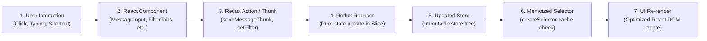

# Quantum Heaps Chat Application

> A high-performance, accessible, and responsive modern chat web application engineered with **React 18**, **TypeScript**, **Redux Toolkit**, and **Tailwind CSS**, inspired by the unified communication paradigms of Slack and WhatsApp Web.

[](https://www.typescriptlang.org/)
[](https://react.dev/)
[](https://redux-toolkit.js.org/)
[](https://tailwindcss.com/)
[](https://vitest.dev/)
[](https://vitest.dev/)

---

## Table of Contents

- [1. Project Overview](#1-project-overview)
- [2. Key Features](#2-key-features)
- [3. Technology Stack](#3-technology-stack)
- [4. Application Architecture & Data Flow](#4-application-architecture--data-flow)
- [5. Project Folder Structure](#5-project-folder-structure)
- [6. Installation Instructions](#6-installation-instructions)
- [7. Development Commands](#7-development-commands)
- [8. Build Instructions](#8-build-instructions)
- [9. Testing Instructions](#9-testing-instructions)
- [10. Redux Toolkit Architecture](#10-redux-toolkit-architecture)
- [11. TypeScript Domain Model](#11-typescript-domain-model)
- [12. Mock API & Data Simulation](#12-mock-api--data-simulation)
- [13. Responsive Design](#13-responsive-design)
- [14. Architectural Decisions](#14-architectural-decisions)
- [15. Assumptions & Trade-offs](#15-assumptions--trade-offs)
- [16. Future Improvements](#16-future-improvements)

---

## 1. Project Overview

The **Quantum Heaps Chat Application** is a production-ready, client-side messaging platform developed to showcase senior frontend engineering practices. It features normalized state management, optimistic UI updates, debounced memoized selectors, client-side progressive delivery simulations, accessible modal dialogs, and comprehensive unit test coverage.

The application functions completely standalone without an external backend or database, using realistic mock services, simulated network latency, and `LocalStorage` persistence.

---

## 2. Key Features

### 🗂️ Conversation & Channel Management
- **Conversation Sidebar**: Displays 1-on-1 direct conversations and group channels with live presence indicators, timestamps, message previews, and unread badges.
- **Debounced Search**: Case-insensitive filtering across direct contact names, group titles, and last-message snippets with an instant clear button.
- **Category Filter Tabs**: Fast switching between **All**, **Unread**, and **Groups** filters with combined query support.
- **Pinned Conversations**: Instant toggle to pin high-priority conversations to the top of the sidebar.
- **User Presence & Status**: Switch current user status between **Online**, **Away**, and **Offline** with timestamped "last seen" tracking.

### 💬 Rich Message Stream & Header
- **Contextual Chat Header**: Displays avatar, status badge, dynamic typing feedback, group member counts, and quick-action triggers.
- **Sent vs. Received Alignment**: Right-aligned green bubbles for sent messages; left-aligned white/slate bubbles with colored sender attribution tags for group messages.
- **Smart Date Separators**: Automated date grouping with sticky badges (`Today`, `Yesterday`, or formatted calendar date).
- **Delivery & Read Indicators**: WhatsApp-style delivery lifecycle with single grey tick (sent), double grey tick (delivered), and double blue tick (read).
- **Intelligent Auto-Scroll**: Smoothly follows new messages when already reading near the bottom, retains scroll position when inspecting message history, and surfaces a floating "Scroll to bottom" button with unread count pills when new messages arrive out of viewport.

### ⚡ Interactive Message Actions
- **Inline Message Editing**: Edit sent messages inline with non-empty validation, `Enter` to save, `Esc` to cancel, and a timestamped `(edited)` tag.
- **Message Soft Deletion**: Delete authored messages with a destructive `ConfirmDialog` confirmation prompt and soft-delete placeholder (`🚫 This message was deleted`).
- **Quoted Message Replies**: Quote any sent or received message with an above-composer `ReplyPreview` banner and nested `MessageReply` bubble featuring click-to-scroll original navigation.
- **Clipboard Copy**: One-click message content copying using the modern Clipboard API with non-intrusive `Toast` feedback notifications.
- **Emoji Reactions**: Quick reaction toolbar (`👍`, `❤️`, `😂`, `😮`, `😢`, `🎉`, `🔥`, `🚀`), optimistic reaction toggle removal, and an accessible, searchable `EmojiPicker`.

### 👥 Group Channel Administration
- **Group Details Drawer**: Slide-out panel presenting channel metadata, description, creation date, member list, online statuses, and admin role badges.
- **Add Group Members Modal**: Multi-select modal allowing channel admins to search available contacts and add multiple members simultaneously with duplicate prevention.
- **Remove Member Flow**: Protected administrative action with modal confirmation dialog to remove eligible members from a channel.
- **Create Group Modal**: Workflow to establish new group channels with name, description, avatar selection, and initial member assignment.

### 🔍 In-Chat Search & UX
- **In-Chat Message Search Drawer**: Search keyword occurrences specifically within the active conversation. Highlights matches, computes total results, and provides Previous/Next match navigation with scroll-into-view flashing.
- **Theme Switching**: Dark and light mode toggle with system preference detection (`prefers-color-scheme`), DOM root synchronization (`.dark`), and `LocalStorage` persistence.
- **Keyboard Shortcuts**: Power-user hotkeys:
  - `Ctrl+K` / `Cmd+K`: Focus conversation search bar.
  - `/`: Open in-chat message search drawer (when not in an active input).
  - `?`: Open keyboard shortcuts reference cheat-sheet modal.
  - `Escape`: Close active modals, slide-out drawers, or cancel active reply/edit modes.
- **Resilient UI States**: Skeleton placeholders (`ConversationSkeleton`, `MessageSkeleton`), contextual empty states, and interactive `ErrorState` components with retry handlers.

---

## 3. Technology Stack

| Layer | Technology | Purpose |
|---|---|---|
| **Core Framework** | React 18.3.1 | Component rendering, hooks, and concurrent features |
| **Language** | TypeScript 5.6.3 | Strict type definitions, discriminated unions, zero `any` |
| **Build Tooling** | Vite 5.4.10 | Instant Hot Module Replacement (HMR) and optimized rollup bundle |
| **State Management** | Redux Toolkit 2.2.8 | Centralized slice state, async thunks, and memoized selectors |
| **React Bindings** | React-Redux 9.1.2 | Strongly typed hooks (`useAppDispatch`, `useAppSelector`) |
| **Styling** | Tailwind CSS 3.4.14 | Utility-first responsive design, dark mode, animations |
| **Icons** | Lucide React 0.453.0 | Consistent modern SVG icons |
| **Forms** | React Hook Form 7.53.1 | Performant composer and modal forms with validation |
| **Testing** | Vitest 2.1.3 | High-performance test runner compatible with Vite |
| **DOM Testing** | React Testing Library 16.0.1 | User-centric component testing and assertions |
| **Code Quality** | ESLint 9 & Prettier 3.3 | Automated linting, code formatting, and typecheck enforcement |

---

## 4. Application Architecture & Data Flow

### 4.1 System Component & Layer Relationship Diagram

The diagram below illustrates the architectural layers and interactions across UI components, feature modules, custom hooks, Redux Toolkit state, mock services, and persistence:

```mermaid
flowchart TD
    subgraph UI_Layer["1. Presentation & UI Layer (React 18)"]
        direction TB
        AppLayout["AppLayout Container"]
        subgraph UI_Components["React UI Components"]
            SidebarComp["ConversationSidebar<br/>(Header, Search, FilterTabs, List, Item)"]
            ChatComp["Active Chat Window<br/>(ChatHeader, MessageList, MessageBubble)"]
            ComposerComp["Message Input Area<br/>(MessageInput, ReplyPreview, EmojiPicker)"]
            DrawersModals["Drawers & Global Modals<br/>(GroupInfoDrawer, ChatSearchDrawer, AddMemberModal, etc.)"]
            CommonUI["Common UI Primitives<br/>(Avatar, Badge, Toast, ConfirmDialog, ThemeToggle)"]
        end
        AppLayout --> SidebarComp
        AppLayout --> ChatComp
        AppLayout --> ComposerComp
        AppLayout --> DrawersModals
        AppLayout --> CommonUI
    end

    subgraph Hooks_Layer["2. Custom Hooks Layer"]
        direction TB
        useChatHook["useChat()<br/>(Dispatch message, trigger typing, cancel reply)"]
        useAutoScrollHook["useAutoScroll()<br/>(Scroll position, unread below counter)"]
        useConvSearchHook["useConversationSearch()<br/>(Debounced filter, clear query)"]
        useKeyShortcutsHook["useKeyboardShortcuts()<br/>(Ctrl+K, '/', '?', Escape)"]
        useDebounceHook["useDebounce()<br/>(Generic value debouncing)"]
    end

    ComposerComp --> useChatHook
    ChatComp --> useAutoScrollHook
    SidebarComp --> useConvSearchHook
    AppLayout --> useKeyShortcutsHook

    subgraph Features_Layer["3. Feature Modules Layer"]
        direction TB
        AuthFeat["features/auth<br/>(User profile, presence)"]
        ConvFeat["features/conversations<br/>(List, search, filter, pin)"]
        MsgFeat["features/messages<br/>(Feed, delivery status, reactions, reply)"]
        GroupFeat["features/groups<br/>(Channels, member admin, modal dialogs)"]
        SettingsFeat["features/settings<br/>(Theme, mobile pane, in-chat search)"]
    end

    useChatHook --> MsgFeat
    useConvSearchHook --> ConvFeat
    useKeyShortcutsHook --> SettingsFeat

    subgraph Redux_Layer["4. Redux Toolkit Centralized Store"]
        direction TB
        Store["Root Redux Store<br/>(configureStore)"]
        
        subgraph Slices["Redux Slices & Reducers"]
            UsersSlice["usersSlice<br/>(entities, ids, currentUserId)"]
            ConvsSlice["conversationsSlice<br/>(entities, filter, searchQuery)"]
            MsgsSlice["messagesSlice<br/>(byConversationId, typingUsers, replyingTo)"]
            GroupsSlice["groupsSlice<br/>(drawer/modal visibility states)"]
            UISlice["uiSlice<br/>(theme, mobilePane, toasts, inChatSearch)"]
        end

        subgraph Selectors["Memoized Reselect Selectors"]
            ConvSelectors["conversationsSelectors<br/>(selectFilteredConversations, selectTotalUnreadCount)"]
            MsgSelectors["messagesSelectors<br/>(selectActiveMessages, selectActiveConversationTypingUsers)"]
            UserSelectors["usersSelectors<br/>(selectCurrentUser, selectUsersEntities)"]
            UISelectors["uiSelectors<br/>(selectTheme, selectMobilePane, selectToasts)"]
        end

        Store --> UsersSlice
        Store --> ConvsSlice
        Store --> MsgsSlice
        Store --> GroupsSlice
        Store --> UISlice

        UsersSlice --> UserSelectors
        ConvsSlice --> ConvSelectors
        MsgsSlice --> MsgSelectors
        UISlice --> UISelectors
    end

    UI_Components -.->|useAppSelector| Selectors
    UI_Components -.->|useAppDispatch| Slices
    Hooks_Layer -.->|dispatch thunk / action| Slices

    subgraph Services_Layer["5. Mock API & Services Layer"]
        direction TB
        ConvService["conversationService<br/>(Async queries & group mutations)"]
        MsgService["messageService<br/>(Async fetch thread & send transport)"]
        SimService["mockSimulationService<br/>(Progressive tick delivery & partner replies)"]
        StorageService["storageService<br/>(Browser storage abstraction)"]
    end

    Slices -->|Async Thunks| MsgService
    Slices -->|Async Thunks| ConvService
    Slices -->|Storage Sync| StorageService
    MsgService -->|Trigger status/reply| SimService
    SimService -->|Dispatch status/typing| Slices

    subgraph Data_Layer["6. Data & Persistence Layer"]
        direction TB
        MockUsersData["src/mock/users.mock.ts<br/>(Contacts, Profiles)"]
        MockConvsData["src/mock/conversations.mock.ts<br/>(Direct chats, Group channels)"]
        MockMsgsData["src/mock/messages.mock.ts<br/>(Preloaded thread histories)"]
        LocalStorage["Browser LocalStorage<br/>(Theme: 'qh_chat_theme', Active conv, Cached convs)"]
    end

    ConvService --> MockConvsData
    MsgService --> MockMsgsData
    ConvService --> MockUsersData
    StorageService <--> LocalStorage
```



### 4.2 Unidirectional Redux Data Flow Diagram

Every state mutation in the application adheres strictly to the unidirectional Redux data flow cycle:



### 4.3 Architectural Layer Responsibilities

1. **Presentation & UI Layer (`src/components/`, `src/features/*/components/`)**:
   - Renders visual layout, semantic accessibility attributes (`role`, `aria-*`), and responsive Tailwind utility styling.
   - Declarative and stateless where possible; delegates user events and state queries to typed Redux hooks (`useAppDispatch`, `useAppSelector`) and custom business hooks.
   - Kept pure and free from direct networking, timer scheduling, or local storage side-effects.

2. **Feature Modules Layer (`src/features/`)**:
   - Organizes the application into self-contained domain features (`auth`, `conversations`, `messages`, `groups`, `settings`).
   - Co-locates slices, thunks, selectors, and domain-specific UI components to maintain strict cohesion and ease of maintenance.

3. **Custom Hooks Layer (`src/hooks/`)**:
   - Encapsulates non-visual business workflows, DOM event listeners, and complex UI orchestration:
     - `useChat`: Orchestrates sending messages, typing simulation schedules, and reply banner cancellation.
     - `useAutoScroll`: Manages scroll-to-bottom behavior, observer cleanup, and unread message counters below the viewport.
     - `useConversationSearch`: Implements debounced query processing and match calculations.
     - `useKeyboardShortcuts`: Handles window keydown event listening for power-user navigation (`Ctrl+K`, `/`, `?`, `Escape`).
     - `useDebounce`: Generic debounce timing utility.

4. **Redux Toolkit Centralized Store Layer (`src/store/`)**:
   - Acts as the single source of truth for the entire application state.
   - Normalizes relational data (`entities` dictionary and `ids` array) to avoid deep nested state trees.
   - Leverages Immer inside slice reducers for safe, immutable state transformations.
   - Manages asynchronous side-effects and optimistic UI updates through `createAsyncThunk`.

5. **Memoized Selectors Layer (`src/features/*/selectors.ts`)**:
   - Built with Reselect's `createSelector` to compute derived, filtered, and aggregated data.
   - Provides memoization and referential caching to ensure components only re-render when their specific sliced data inputs change.

6. **Mock API & Simulation Services Layer (`src/services/`)**:
   - Simulates realistic network transport with latency (`setTimeout`) for conversations, messages, and group operations.
   - `mockSimulationService`: Operates as a synthetic WebSocket server, advancing delivery status ticks (`sent` &rarr; `delivered` &rarr; `read`) and generating simulated partner typing and automated replies.
   - `storageService`: Manages synchronized browser persistence with defensive JSON parsing.

7. **Mock Data & Persistence Layer (`src/mock/`, `localStorage`)**:
   - Seed fixtures (`mockUsers`, `mockConversations`, `mockMessagesByConversationId`) provide rich, deterministic initial state for development and testing.
   - Browser `localStorage` persists theme mode, active conversation pointers, and conversation updates across page refreshes.

---

## 5. Project Folder Structure

The project follows a **Feature-Driven Architecture** combined with shared modular layers:

```
quantum-heaps-chat/
├── index.html                      # HTML template entry point
├── package.json                    # Project dependencies & scripts
├── tsconfig.json                   # TypeScript configuration
├── vite.config.ts                  # Vite build & test configuration
├── tailwind.config.js              # Tailwind theme, colors, and dark mode setup
├── src/
│   ├── main.tsx                    # React application bootstrap & Redux Provider
│   ├── App.tsx                     # Top-level application component
│   ├── index.css                   # Tailwind directives and custom scrollbar styles
│   │
│   ├── components/                 # Shared presentation components
│   │   ├── common/                 # Reusable UI primitives (Avatar, Badge, Toast, etc.)
│   │   │   ├── Avatar.tsx
│   │   │   ├── Badge.tsx
│   │   │   ├── Button.tsx
│   │   │   ├── ConfirmDialog.tsx
│   │   │   ├── ConversationSkeleton.tsx
│   │   │   ├── EmptyState.tsx
│   │   │   ├── ErrorState.tsx
│   │   │   ├── IconButton.tsx
│   │   │   ├── MessageSkeleton.tsx
│   │   │   ├── MessageStatusIcon.tsx
│   │   │   ├── Notification.tsx
│   │   │   ├── ThemeToggle.tsx
│   │   │   └── Toast.tsx
│   │   └── layout/                 # Layout wrappers & global modal dialogs
│   │       ├── AppLayout.tsx
│   │       └── KeyboardShortcutsModal.tsx
│   │
│   ├── features/                   # Domain features (state slices, selectors, components)
│   │   ├── auth/                   # Current user profile & status slice
│   │   │   ├── usersSlice.ts
│   │   │   └── components/UserProfileModal.tsx
│   │   ├── conversations/          # Sidebar, search, and category filters
│   │   │   ├── conversationsSlice.ts
│   │   │   ├── conversationsSelectors.ts
│   │   │   └── components/
│   │   │       ├── ConversationSidebar.tsx
│   │   │       ├── SidebarHeader.tsx
│   │   │       ├── ConversationSearch.tsx
│   │   │       ├── ConversationFilterTabs.tsx
│   │   │       ├── ConversationList.tsx
│   │   │       └── ConversationItem.tsx
│   │   ├── messages/               # Message feed, input, actions, reactions & drawer
│   │   │   ├── messagesSlice.ts
│   │   │   ├── messagesSelectors.ts
│   │   │   └── components/
│   │   │       ├── ChatHeader.tsx
│   │   │       ├── MessageList.tsx
│   │   │       ├── MessageBubble.tsx
│   │   │       ├── MessageInput.tsx
│   │   │       ├── MessageStatus.tsx
│   │   │       ├── TypingIndicator.tsx
│   │   │       ├── MessageActionsToolbar.tsx
│   │   │       ├── MessageReactions.tsx
│   │   │       ├── MessageReply.tsx
│   │   │       ├── ReplyPreview.tsx
│   │   │       ├── ChatSearchDrawer.tsx
│   │   │       ├── EmojiPicker.tsx
│   │   │       └── DateSeparator.tsx
│   │   ├── groups/                 # Group info, add member, create group modals
│   │   │   ├── groupsSlice.ts
│   │   │   └── components/
│   │   │       ├── GroupInfoDrawer.tsx
│   │   │       ├── GroupInfo.tsx
│   │   │       ├── GroupMember.tsx
│   │   │       ├── AddMemberModal.tsx
│   │   │       └── CreateGroupModal.tsx
│   │   └── settings/               # UI settings, themes, notifications, drawer states
│   │       └── uiSlice.ts
│   │
│   ├── hooks/                      # Custom business logic & orchestration hooks
│   │   ├── useAutoScroll.ts        # Dynamic scroll-to-bottom and unread tracking
│   │   ├── useChat.ts              # Sending messages and typing simulation triggers
│   │   ├── useConversationSearch.ts# Debounced conversation filter hook
│   │   ├── useDebounce.ts          # Generic debounce utility hook
│   │   └── useKeyboardShortcuts.ts # Window keyboard hotkey controller
│   │
│   ├── mock/                       # Deterministic seed mock datasets
│   │   ├── conversations.mock.ts
│   │   ├── messages.mock.ts
│   │   └── users.mock.ts
│   │
│   ├── services/                   # Mock API services, simulations & storage
│   │   ├── conversationService.ts  # Async conversation queries & mutations
│   │   ├── messageService.ts       # Async message transport & pagination
│   │   ├── mockSimulationService.ts# Progressive delivery & auto-reply engine
│   │   └── storageService.ts       # LocalStorage hydration helper
│   │
│   ├── store/                      # Redux store configuration
│   │   ├── index.ts                # Store instance & re-exported slice actions
│   │   ├── rootReducer.ts          # Combined root reducer & RootState type
│   │   └── hooks.ts                # Typed Redux hooks (useAppDispatch, useAppSelector)
│   │
│   ├── test/                       # Test suite setup & master unit test suite
│   │   ├── setup.ts                # Vitest jsdom polyfills (scrollIntoView, clipboard)
│   │   ├── testUtils.tsx           # Typed renderWithProviders harness
│   │   └── unitTestSuite.test.tsx  # Master unit test suite covering Tasks 1 - 36
│   │
│   ├── types/                      # Domain TypeScript interfaces & discriminated unions
│   │   ├── user.types.ts
│   │   ├── conversation.types.ts
│   │   ├── message.types.ts
│   │   ├── ui.types.ts
│   │   └── index.ts
│   │
│   └── utils/                      # Pure functional helper utilities
│       ├── classNames.ts           # clsx + tailwind-merge helper (cn)
│       ├── dateUtils.ts            # Date formatting (timestamps, last seen, separators)
│       ├── messageGrouper.ts       # Groups messages into chronological date clusters
│       └── typingUtils.ts          # Formats "Sarah is typing..." string logic
```

---

## 6. Installation Instructions

### Prerequisites
- **Node.js**: `v18.0.0` or higher (Node 20+ recommended).
- **Package Manager**: `npm` (v9+), `pnpm` (v8+), or `yarn` (v1.22+).

### Setup Steps
1. Navigate into the repository root:
   ```bash
   cd "Quantum Heaps Chat Application"
   ```
2. Install project dependencies:
   ```bash
   npm install
   ```

---

## 7. Development Commands

Start the local Vite development server with Hot Module Replacement (HMR):

```bash
npm run dev
```

- Local URL: `http://localhost:5173/`
- Network URL: Displayed in the terminal output for mobile testing on the local network.

### Code Quality Commands

- **Run Linter**:
  ```bash
  npm run lint
  ```
- **Automatically Fix Lint Errors**:
  ```bash
  npm run lint:fix
  ```
- **Format Codebase with Prettier**:
  ```bash
  npm run format
  ```

---

## 8. Build Instructions

Execute strict TypeScript compilation followed by Vite asset bundling:

```bash
npm run build
```

The compiled, minified production assets are generated in the `dist/` directory:
- `dist/index.html`: Entry HTML with hashed script and stylesheet links.
- `dist/assets/*.js`: Code-split JavaScript bundles.
- `dist/assets/*.css`: Purged and minified Tailwind utility classes.

### Preview Production Build Locally
Verify the production build using Vite's built-in preview server:

```bash
npm run preview
```

---

## 9. Testing Instructions

The application uses **Vitest** with **React Testing Library** and `@testing-library/jest-dom` for component and integration verification.

### Run All Tests
Execute all 19 test files (192 unit tests):

```bash
npm test
```

### Run Tests in Watch Mode
Launch the interactive watcher during active development:

```bash
npm run test:watch
```

### Test Coverage Highlights
All core features are verified across 19 dedicated test suites:
- **`src/test/unitTestSuite.test.tsx`**: 58-test master suite covering all 14 evaluation requirements:
  1. Conversation sidebar rendering
  2. Conversation search
  3. All, Unread, and Groups filters
  4. Selecting a conversation
  5. Message list rendering
  6. Sending a message
  7. Editing a message
  8. Deleting a message
  9. Replying to a message
  10. Copying a message
  11. Emoji reactions
  12. Group member management
  13. Theme switching
  14. Keyboard shortcuts
- **`src/features/conversations/conversationSearch.test.tsx`**: Debounce timing, empty states, and query reset.
- **`src/features/conversations/conversationFilter.test.tsx`**: Tab state transitions, badge synchronization, and combined search-filter logic.
- **`src/features/messages/messageSending.test.tsx`**: Enter key, Shift+Enter newline, empty validation, and progressive delivery simulation.
- **`src/features/messages/messageInteractions.test.tsx`**: Edit/delete author boundaries, reply quoting, clipboard integration, and emoji reaction toggles.
- **`src/features/groups/groupManagement.test.tsx`**: Drawer opening, member search, multi-selection addition, and removal dialogs.
- **`src/features/system/systemFeatures.test.tsx`**: Mobile pane switching, theme toggle class synchronization, match navigation, and keyboard shortcut triggers.
- **`src/hooks/useAutoScroll.test.ts` & `src/hooks/useDebounce.test.ts`**: Pure hook testing.
- **`src/store/store.test.ts`**: Redux slice reducers, async thunks, and memoized selector logic.

---

## 10. Redux Toolkit Architecture

State management is centralized with **Redux Toolkit (RTK)** using normalized data structures and memoized selectors.

```
                          +------------------------+
                          |   Redux Store (RTK)    |
                          +-----------+------------+
                                      |
         +----------------+-----------+------------+----------------+
         |                |                        |                |
+--------v-------+ +------v-------------+ +--------v-------+ +------v-------+
|   usersSlice   | | conversationsSlice | | messagesSlice  | |   uiSlice    |
| (entities, ids)| |  (entities, filter)| |(byConversation)| |(theme, pane) |
+----------------+ +--------------------+ +----------------+ +--------------+
```

### 1. Normalized Slices
- **`usersSlice`**: Normalizes user profiles into an `entities: Record<string, User>` dictionary and `ids: string[]` array. Manages current user authentication profile and presence states.
- **`conversationsSlice`**: Stores conversations in an `entities: Record<string, Conversation>` map. Tracks `activeConversationId`, `filter` (`'all' | 'unread' | 'groups'`), and debounced `searchQuery`.
- **`messagesSlice`**: Partitions messages by conversation ID (`byConversationId: Record<string, Message[]>`). Avoids global scans across unrelated chats. Manages `typingUsers`, `replyingTo`, and `editingMessage` states.
- **`groupsSlice`**: Controls drawer visibility (`isGroupInfoDrawerOpen`) and modal triggers (`isAddMemberModalOpen`, `isCreateGroupModalOpen`).
- **`uiSlice`**: Manages global UI presentation: theme (`'light' | 'dark'`), mobile pane (`'sidebar' | 'chat'`), in-chat search query, and a queue of dismissible toasts (`toasts: ToastNotification[]`).

### 2. Resilient Memoized Selectors (`createSelector`)
Selectors compute derived data efficiently, preventing unnecessary component re-renders:
- `selectFilteredConversations`: Combines conversation entities, the active filter, and search queries with memoization.
- `selectActiveMessages`: Retrieves messages strictly for the active thread.
- `selectTotalUnreadCount`: Computes global unread badges across all conversations.
- `selectActiveConversationTypingUsers`: Filters typing events for the active conversation, ignoring other background threads.

---

## 11. TypeScript Domain Model

The codebase is written in strict TypeScript without `any` types, leveraging discriminated unions and type guards.

### Core Domain Interfaces (`src/types/`)

```typescript
// Discriminated union for Conversations
export interface BaseConversation {
  id: string;
  avatarUrl?: string;
  lastMessage?: Message;
  updatedAt: string;
  createdAt: string;
  unreadCount: number;
  isPinned?: boolean;
  isMuted?: boolean;
  draft?: string;
}

export interface DirectConversation extends BaseConversation {
  type: 'direct';
  participantIds: [string, string];
}

export interface GroupConversation extends BaseConversation {
  type: 'group';
  name: string;
  description: string;
  members: GroupMember[];
  createdById: string;
}

export type Conversation = DirectConversation | GroupConversation;

// Message & Delivery Model
export type MessageStatus = 'sent' | 'delivered' | 'read';

export interface MessageReaction {
  emoji: string;
  userIds: string[];
  count: number;
}

export interface MessageReply {
  messageId: string;
  senderId: string;
  senderName: string;
  content: string;
}

export interface Message {
  id: string;
  conversationId: string;
  senderId: string;
  content: string;
  timestamp: string;
  status: MessageStatus;
  replyTo?: MessageReply;
  reactions?: MessageReaction[];
  isEdited?: boolean;
  editedAt?: string;
  isDeleted?: boolean;
  deletedAt?: string;
}
```

### Type Guards
Helper utilities ensure type narrowing throughout UI components:
```typescript
export function isGroupConversation(conv: Conversation): conv is GroupConversation {
  return conv.type === 'group';
}

export function isDirectConversation(conv: Conversation): conv is DirectConversation {
  return conv.type === 'direct';
}
```

---

## 12. Mock API & Data Simulation

Because the application is designed to run self-contained, real-world network and messaging lifecycles are modeled through client-side simulation services:

```
[User Dispatches Message]
        │
        ├──> 1. Optimistic Update in Redux (status: 'sent', single grey tick)
        │
        ├──> 2. Progressive Delivery Simulation (`mockSimulationService`)
        │       ├── +800ms:  Status advances to 'delivered' (double grey ticks)
        │       └── +1600ms: Status advances to 'read' (double blue ticks)
        │
        └──> 3. Partner Activity Simulation
                ├── +2200ms: Target contact starts typing (animated bouncing dots)
                └── +4500ms: Target contact sends contextual automated reply
```

### Service Implementations
- **`conversationService`**: Simulates asynchronous network requests with realistic delay (`setTimeout`) for conversation fetching, pinning, and member management.
- **`messageService`**: Handles message pagination, thread fetching, and async send payloads.
- **`mockSimulationService`**: Schedules timers to advance message statuses progressively and triggers partner auto-replies. Timers are automatically tracked and cleared to avoid memory leaks.
- **`storageService`**: Safely syncs theme settings and conversation changes to browser `localStorage` with JSON serialization error handling.

---

## 13. Responsive Design

The interface adapts across screen sizes using Tailwind CSS responsive breakpoints (`sm:`, `md:`, `lg:`):

```
DESKTOP (>= 1024px)
+---------------------------------------------------------+
| [ Sidebar: 380px ] | [ Active Chat Area: Remaining ]    |
+---------------------------------------------------------+

TABLET (768px - 1023px)
+---------------------------------------------------------+
| [ Sidebar: 320px ] | [ Active Chat Area: Remaining ]    |
+---------------------------------------------------------+

MOBILE (< 768px)
State A: mobilePane === 'sidebar'   State B: mobilePane === 'chat'
+-------------------------------+   +-------------------------------+
| [ Fullscreen Sidebar / List ] |   | [ Header with Back Button ]   |
| (Selects conversation)        |   | [ Fullscreen Active Feed ]    |
|               ────>           |   | [ Message Composer Area ]     |
+-------------------------------+   +-------------------------------+
```

### Mobile Layout Behaviors
- **Single Pane Navigation**: On screens below `768px`, the application displays either the sidebar or the active conversation feed based on `uiSlice.mobilePane`.
- **Seamless Transition**: Selecting a conversation transitions the view to `'chat'`. The chat header automatically exposes an accessible **Back button** that dispatches `setMobilePane('sidebar')` to return to the conversation list.
- **Touch-Optimized**: Buttons and action icons provide a minimum `44x44px` touch target, preventing accidental clicks on mobile devices.
- **Responsive Modals**: Modals and slide-out drawers render full-screen or as bottom sheets on mobile viewports, complete with backdrop blur and tap-to-dismiss behavior.

---

## 14. Architectural Decisions

1. **Feature-Driven Directory Structure**:
   Co-locating slices, selectors, hooks, and presentation components by domain feature (`conversations`, `messages`, `groups`, `auth`, `settings`) makes the codebase maintainable, modular, and easy to scale.
2. **Partitioned Message State**:
   Storing messages partitioned by conversation ID (`byConversationId: Record<string, Message[]>`) ensures message insertions, edits, and deletions operate in constant time $O(1)$ without re-allocating arrays for other conversations.
3. **Controlled / Uncontrolled Form Balance**:
   The message composer utilizes **React Hook Form** to register input handlers without triggering top-level component re-renders on every single keystroke.
4. **Optimistic UI Updates with Rollback Support**:
   Emoji reactions, message sending, and theme toggling update the UI immediately before background service timers resolve, delivering a responsive user experience.
5. **Decoupled Business Hooks**:
   Core logic (such as auto-scrolling with resize observers, keyboard navigation, and debounced searching) is encapsulated in reusable custom hooks (`useAutoScroll`, `useKeyboardShortcuts`, `useConversationSearch`), keeping presentation components lean.

---

## 15. Assumptions & Trade-offs

- **Client-Side Simulation vs. Real WebSockets**:
  *Decision*: WebSocket communication and server responses are simulated via client services (`mockSimulationService`).
  *Trade-off*: Eliminates the need for external server infrastructure or database setup during evaluation while demonstrating realistic real-time UX.
- **Seed Data with LocalStorage Fallback**:
  *Decision*: Seed conversations hydrate from deterministic mock data and persist state changes to `LocalStorage`.
  *Trade-off*: Provides state persistence across browser reloads while guaranteeing tests run against predictable initial state.
- **Soft Deletion Pattern**:
  *Decision*: Deleting a message preserves the record with `isDeleted: true` and replaces its content with a placeholder.
  *Trade-off*: Maintains thread continuity and reply quotation integrity while matching industry standards (Slack & WhatsApp).

---

## 16. Future Improvements

- **WebSocket / Server-Sent Events (SSE) Integration**: Replace mock simulation services with real-time bidirectional WebSocket connections.
- **Virtualized Message Feed**: Implement windowing via `@tanstack/react-virtual` to support rendering 10,000+ messages per channel at 60 FPS.
- **Real File & Media Pipeline**: Add client-side image compression, audio waveform rendering for voice notes, and presigned S3 upload pipelines.
- **End-to-End Automation**: Complement the existing Vitest unit test suite with Playwright or Cypress tests for cross-browser testing.
- **WebRTC Calling**: Expand the mock audio/video header action buttons into real peer-to-peer calling using WebRTC.

---

## License

This project is licensed under the MIT License. Developed as a Senior Frontend Developer technical implementation showcase.
